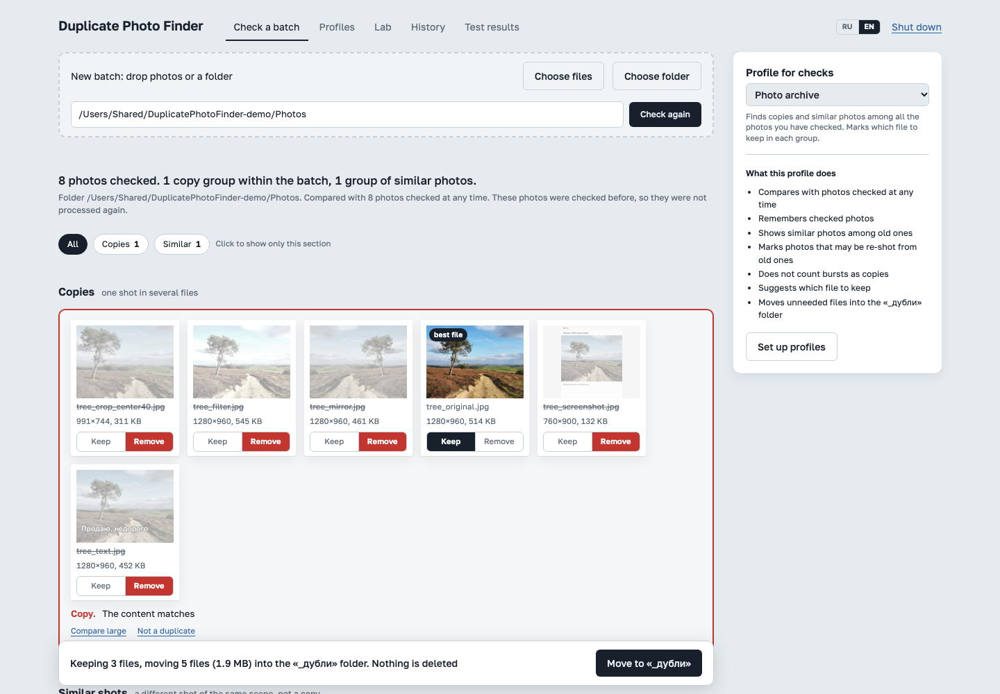

# Duplicate Photo Finder

[Русский](README.md)

Duplicate Photo Finder finds identical and similar photos in a folder and helps you set the extra copies aside. It recognizes a copy even when the photo was cropped, recompressed, mirrored, captioned or captured as a screenshot. Burst shots taken one after another are not treated as copies.

Everything runs on your computer: photos are never uploaded, and no internet connection is needed to work. It goes online only when you click "Check for updates": it then reads the newest version number from GitHub and sends nothing else. The program never deletes anything. It moves extra files into a folder named `_дубли` ("duplicates"), and one button puts them back.

The interface is in English and Russian. It opens in Russian if your system language is Russian, otherwise in English; switch at any time with RU | EN in the top right corner.

Photo in the screenshot: Kreuzschnabel, Wikimedia Commons, CC BY-SA 3.0.

## Download

| Version | Mac | Windows |
|---|---|---|
| 1.2 | [Download for Mac](https://github.com/dwenlvov/duplicate-photo-finder/raw/main/builds/DuplicatePhotoFinder-1.2-mac-arm64.dmg) (87 MB) | [Download for Windows](https://github.com/dwenlvov/duplicate-photo-finder/raw/main/builds/DuplicatePhotoFinder-1.2-windows-x64.zip) (97 MB) |

- **Mac:** Apple silicon (M1 or later) and macOS 14 Sonoma or later. Macs with an Intel processor are not supported. To check, open the Apple menu > About This Mac and look at the line labeled "Chip".
- **Windows:** Windows 10 or 11, 64-bit. To check, open Settings > System > About and look at the line labeled "System type".

Supported formats: JPG, PNG, WebP, HEIC (iPhone photos), TIFF and BMP. Camera RAW files and videos are skipped.

Each download also contains the same guide as `README.en.txt` (English) and `README.ru.txt` (Russian), with more detail on first start and removal.

## Install on a Mac

1. Double-click the downloaded `.dmg` file. A window opens with the Duplicate Photo Finder app and an Applications folder.
2. Drag Duplicate Photo Finder onto the Applications folder in that window.
3. Close the window and eject the Duplicate Photo Finder disk: click the eject button next to it in the Finder sidebar, or drag its desktop icon to the Trash.
4. Open Duplicate Photo Finder from your Applications folder.

The first time, macOS refuses to open the app because it is not signed with Apple, and shows a warning. You allow it once:

- **macOS 15 or later:** click "Done" in the warning. Open System Settings > Privacy & Security and scroll down. You will see a message that Duplicate Photo Finder was blocked, with an "Open Anyway" button: click it, enter your Mac password, then click "Open". The message only appears for about an hour after you try to open the app; if it is not there, open the app from Applications again and come back.
- **macOS 14:** right-click Duplicate Photo Finder in Applications, choose "Open", then click "Open" again.

After 10 to 20 seconds a new tab titled Duplicate Photo Finder opens in your default browser. The app has no window of its own; everything happens in that tab. While it runs, its icon sits in the menu bar near the clock: two photos, one over the other. Use it to open the page again or to shut the program down. If no tab appears, open http://127.0.0.1:8777/ in your browser.

## Install on Windows

1. Find the downloaded `DuplicatePhotoFinder-1.2-windows-x64.zip`, usually in your Downloads folder. Select it and press Alt+Enter to open Properties (or right-click > Properties; on Windows 11 it may be under "Show more options"). If the General tab has an "Unblock" checkbox at the bottom, tick it and click OK. Without this, Windows shows more warnings later.
2. Right-click the archive > "Extract All", choose a place to keep the program, such as Documents, and click "Extract". A folder named DuplicatePhotoFinder appears there. The program does not run from inside the archive.
3. Open the DuplicatePhotoFinder folder. It contains a few files and two folders. Double-click `start.bat`. If Windows hides file extensions, it shows as "start" with a gear icon.

Windows may warn about an unknown publisher:

- "Windows protected your PC": click the small "More info" link; a "Run anyway" button then appears. Click it.
- "Open File - Security Warning": click "Run".

A black window opens with a few lines of text in Russian and English. Within a few seconds a new tab titled Duplicate Photo Finder opens in your default browser. Keep the black window open while you work: closing it shuts the program down. The program's icon also appears by the clock in the bottom right corner; Windows may tuck it under the "^" arrow. Click it to open the page, or right-click it for a menu with "Shut down". If no tab appears, open http://127.0.0.1:8777/ in your browser. If that number is taken by another program, the black window shows the actual address on the line starting with "Open:".

## Check a folder

1. On the "Check a batch" tab, click "Choose folder" and pick your photo folder. Subfolders are included. The folder picker may open behind the browser window; if nothing seems to happen, look for it there.
   On a Mac, the first time you check a folder in Documents, Desktop or Downloads, macOS asks whether Duplicate Photo Finder may access it. Click "Allow", or the program sees no photos.
2. While it runs, the stages of the check are listed under the buttons. The current stage shows how far it has got, for example "Analysing new photos 120 of 800". When the check is finished, the list gives way to a line such as "800 photos checked", with the results below it.
3. The results are grouped. "Copies" are the same photo saved more than once, possibly cropped, compressed or mirrored. "Similar shots" are different photos of the same place, or a burst. In each group of copies the program marks one file "Keep", usually the largest, and the rest "Remove". Similar shots are all marked "Keep" by default. Each photo has a "Keep" and a "Remove" button under it to change its mark. Click a photo to open it full screen. "Compare large" under a group shows all its photos side by side, with the same buttons.
4. A panel titled "Move to «_дубли»" sits to the right of the results and shows how many files will go into that folder and how many stay in place. In a narrow browser window the panel sits at the bottom of the screen instead. Click the button with the number of files on it, for example "Move 12 files", then "Yes, move".
5. The panel then shows "✓ Moved 12 files" with their total size, and the moved photos leave the list on the page. The files marked "Remove" are now in a `_дубли` folder inside the folder you checked, keeping the same subfolders. "Open the «_дубли» folder" opens it in Finder or File Explorer.

If you change your mind, click "Put back" on the same panel.

The program can mistake a different photo for a copy. If you later want to delete the `_дубли` folder yourself, look through it first.

Photos kept in the Apple Photos app live inside its library, which the program does not touch. To check them, export them from Photos into an ordinary folder first.

## Update

In the top right corner, next to RU | EN, click the version number, for example "1.2", then click "Check for updates" in the small panel that opens. If a newer version is out, an "Open the download page" link appears; it opens this page on GitHub. Download the new version from the table above and install it the same way as the first one. On a Mac, drag it onto Applications and agree to replace the old one. On Windows, shut the program down and replace the old DuplicatePhotoFinder folder with the new one. Your marks, history and moves stay: they live in the data folder, apart from the program.

## Quit

Click "Shut down" in the top right corner of the page, then confirm, or choose "Shut down" in the menu of the program's icon by the clock. On Windows you can also close the black window.

## Data and removal

The program remembers checked photos, so it does not process them again and can spot a repeat of an old photo. This data lives in `~/Library/Application Support/Duplicate Photo Finder` on a Mac (in Finder: Go > Go to Folder, paste the path) and in `%LOCALAPPDATA%\Duplicate Photo Finder` on Windows (paste it into the File Explorer address bar).

To remove the program completely: quit it, delete the app (Duplicate Photo Finder in Applications, or the DuplicatePhotoFinder folder on Windows), and delete the data folder. The `_дубли` folders inside your photo folders stay: they hold your files.

## Troubleshooting

- **The Mac says the app is not supported, or its icon is crossed out:** the Mac has an Intel processor or runs macOS older than 14.
- **No browser tab opened:** open http://127.0.0.1:8777/ in your browser. On Windows, if that does not work, use the address on the line starting with "Open:" in the black window.
- **The folder picker does not appear:** it may be behind the browser window. You can also type the folder path into the field under the buttons and click "Check this folder".
- **Windows mentions msvcp140.dll or vcruntime140.dll:** install the Microsoft Visual C++ Redistributable for x64 from Microsoft's website and run `start.bat` again.

## For developers

The source code is in `dedup`. The builds are made by the scripts in `packaging`: `bash packaging/build_mac.sh` on an Apple silicon Mac (requires [uv](https://docs.astral.sh/uv/)) and `bash packaging/build_windows.sh` on a Mac or Linux. The version number comes from the `VERSION` file, and finished builds go into `builds`. GitHub rejects files of 100 MB or more, so the scripts stop if a build reaches that size.

How it works: for every photo the program computes a PDQ perceptual hash, an embedding from SSCD, a neural network trained for image copy detection, and ORB keypoints for precise matching. The network runs on a regular CPU; no graphics card is needed.

## License

The code is released under the MIT license, see [LICENSE](LICENSE). The SSCD model was created by Meta and is also MIT-licensed. Authors, library licenses and required notices are in [THIRD_PARTY_NOTICES.md](THIRD_PARTY_NOTICES.md).
