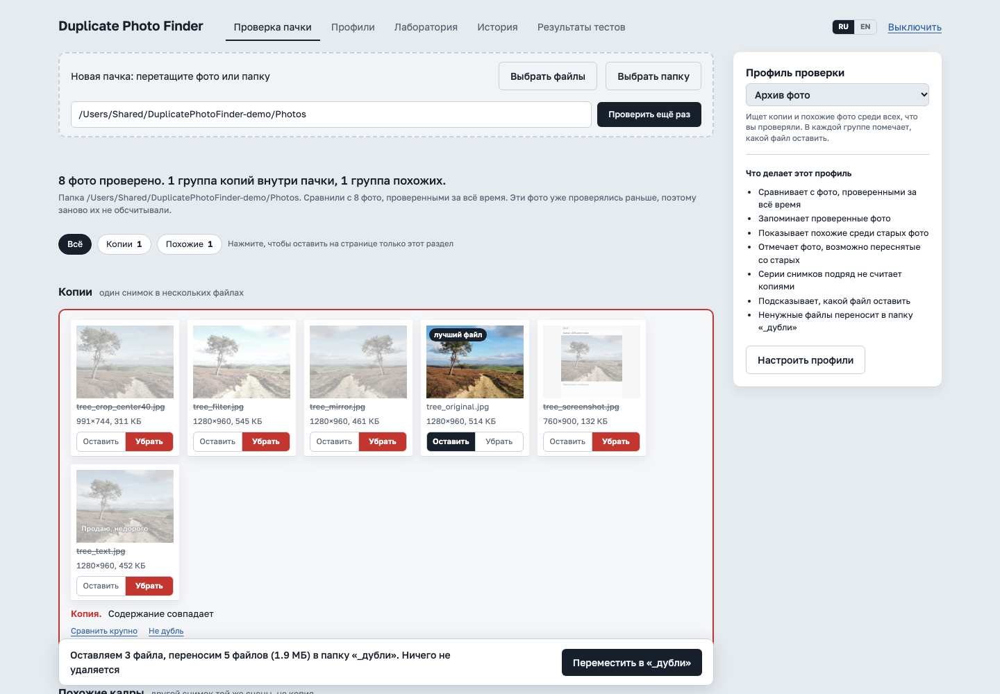

# Duplicate Photo Finder

[English](README.en.md)

Находит в папке с фото одинаковые и похожие снимки и помогает убрать лишние. Узнаёт копию, даже если фото обрезали, пересжали, отразили, подписали или сделали с него скриншот. Серию снимков подряд копией не считает.

Работает только на вашем компьютере, фото никуда не отправляются, интернет для работы не нужен. В интернет программа выходит только по кнопке «Проверить обновления»: тогда она узнаёт на GitHub номер последней версии и больше ничего не передаёт. Сама программа ничего не удаляет: лишние файлы она переносит в папку `_дубли`, и их можно вернуть одной кнопкой.

Интерфейс на русском и английском, язык переключается кнопками RU и EN в правом верхнем углу.

Фото на снимке экрана: Kreuzschnabel, Wikimedia Commons, CC BY-SA 3.0.

## Скачать

| Версия | Mac | Windows |
|---|---|---|
| 1.2 | [Скачать для Mac](https://github.com/dwenlvov/duplicate-photo-finder/raw/main/builds/DuplicatePhotoFinder-1.2-mac-arm64.dmg) (87 МБ) | [Скачать для Windows](https://github.com/dwenlvov/duplicate-photo-finder/raw/main/builds/DuplicatePhotoFinder-1.2-windows-x64.zip) (97 МБ) |

- **Mac:** процессор Apple (M1 и новее) и macOS 14 Sonoma или новее. На Mac с процессором Intel не работает. Узнать процессор: меню Apple (яблоко слева вверху) > «Об этом Mac», строка «Чип».
- **Windows:** Windows 10 или 11, 64-разрядная. Проверить: «Параметры» > «Система» > «О системе», строка «Тип системы».

Программа читает JPG, PNG, WebP, HEIC (фото с iPhone), TIFF и BMP. Файлы RAW с фотоаппаратов и видео пропускает.

В каждой сборке лежит подробная инструкция: `README.ru.txt` на русском и `README.en.txt` на английском. Ниже коротко.

## Установка на Mac

1. Откройте скачанный файл `.dmg` двойным щелчком. Откроется окно с программой Duplicate Photo Finder и папкой Applications.
2. Перетащите Duplicate Photo Finder на папку Applications в этом окне.
3. Закройте окно и извлеките диск Duplicate Photo Finder в боковой панели Finder.
4. Откройте Duplicate Photo Finder из «Программ» двойным щелчком.

Первый раз macOS программу не откроет: она не подписана в Apple. Разрешить запуск нужно один раз:

- **macOS 15 и новее:** в предупреждении нажмите «Готово». Откройте «Системные настройки» > «Конфиденциальность и безопасность», пролистайте вниз до строки о том, что Duplicate Photo Finder заблокирован, и нажмите «Всё равно открыть». Введите пароль от Mac и нажмите «Открыть». Строка держится около часа после попытки запуска: если её нет, ещё раз откройте программу из «Программ».
- **macOS 14:** щёлкните Duplicate Photo Finder в «Программах» правой кнопкой, выберите «Открыть», затем ещё раз «Открыть».

Через 10–20 секунд в браузере откроется страница Duplicate Photo Finder. Окна у самой программы нет: всё происходит на этой странице. Пока программа работает, в строке меню рядом с часами виден её значок: две фотографии, одна поверх другой. Через него можно снова открыть страницу или выключить программу.

## Установка на Windows

1. Найдите скачанный архив, обычно он в «Загрузках». Выделите его и нажмите Alt+Enter, откроются «Свойства». Можно и правой кнопкой > «Свойства», но в Windows 11 этот пункт бывает спрятан в «Показать дополнительные параметры». Если на вкладке «Общие» внизу есть флажок «Разблокировать», поставьте его и нажмите «ОК».
2. Снова правой кнопкой по архиву > «Извлечь все», укажите, где хранить программу, например «Документы», и нажмите «Извлечь». Там появится папка DuplicatePhotoFinder. Из самого архива, без извлечения, программа не работает.
3. В папке DuplicatePhotoFinder запустите `start.bat` двойным щелчком. Если Windows скрывает расширения файлов, он показан как «start» со значком шестерёнки.

Windows может предупредить о неизвестном издателе:

- «Система Windows защитила ваш компьютер»: нажмите мелкую ссылку «Подробнее», после неё появится кнопка «Выполнить в любом случае».
- «Предупреждение системы безопасности»: нажмите «Запустить».

Откроется чёрное окно, а через несколько секунд в браузере появится страница Duplicate Photo Finder. Чёрное окно не закрывайте, пока работаете: закрыть его значит выключить программу. Ещё у часов внизу справа появится значок программы, иногда он спрятан под стрелкой «^». Щелчок по нему открывает страницу, щелчок правой кнопкой показывает меню с пунктом «Выключить».

## Как проверить папку

1. На вкладке «Проверка пачки» нажмите «Выбрать папку» и укажите папку с фото. Вложенные папки тоже проверяются. На Mac при первой проверке папки из «Документов», «Рабочего стола» или «Загрузок» нажмите «Разрешить» в вопросе macOS о доступе.
2. Пока идёт проверка, под кнопками виден список её этапов. У текущего этапа написано, сколько сделано, например «Разбор новых фото 120 из 800». Когда проверка закончится, вместо списка появятся фраза вида «800 фото проверено» и разделы с найденным.
3. «Копии» это один снимок в нескольких файлах, «Похожие кадры» это разные снимки одного места или серия подряд. В каждой группе копий программа сама отмечает лучший файл «Оставить», остальные «Убрать». Отметку можно поменять кнопками под каждым фото. Нажмите на фото, чтобы открыть его во весь экран. «Сравнить крупно» под группой показывает все её фото рядом, с теми же кнопками.
4. Справа от результатов видна панель «Перенос в «_дубли»»: сколько файлов уйдёт в эту папку и сколько останется на месте. Если окно браузера узкое, панель стоит внизу экрана. Нажмите на ней кнопку с числом файлов, например «Переместить 12 файлов», затем «Да, переместить». На панели появится строка «✓ Перемещено 12 файлов», а перенесённые фото пропадут из списка на странице. Файлы с отметкой «Убрать» теперь лежат в папке `_дубли` внутри проверенной папки, с теми же вложенными папками. Кнопка «Открыть папку «_дубли»» открывает её в Finder или Проводнике.

Передумали: на той же панели нажмите «Вернуть на место».

Программа может ошибиться и принять за копию другое фото. Если захотите удалить папку `_дубли` сами, сначала просмотрите её.

Фото из приложения «Фото» на Mac лежат внутри его медиатеки, программа её не трогает. Чтобы проверить их, выгрузите фото из «Фото» в обычную папку.

## Как обновить

Вверху справа, рядом с RU | EN, нажмите номер версии, например «1.2», и в открывшемся окошке нажмите «Проверить обновления». Если вышла новая версия, появится ссылка «Открыть страницу загрузки», она открывает эту страницу на GitHub. Скачайте новую версию из таблицы выше и поставьте её так же, как первую. На Mac перетащите программу на Applications и согласитесь заменить старую. На Windows выключите программу и замените старую папку DuplicatePhotoFinder новой. Отметки, история и перенос сохраняются: они лежат в папке с данными, отдельно от программы.

## Как выключить

Нажмите «Выключить» в правом верхнем углу страницы или выберите «Выключить» в меню значка программы у часов. В Windows можно ещё закрыть чёрное окно.

## Данные и удаление

Программа помнит проверенные фото, чтобы не считать их заново и найти повтор старого фото. Эти данные лежат в папке `~/Library/Application Support/Duplicate Photo Finder` на Mac и `%LOCALAPPDATA%\Duplicate Photo Finder` в Windows.

Удалить программу полностью: выключите её, удалите саму программу (Duplicate Photo Finder из «Программ» или папку DuplicatePhotoFinder) и папку с данными. Папки `_дубли` в ваших папках с фото остаются: в них ваши файлы.

## Если не запускается

- **Mac пишет, что программа не поддерживается, или значок перечёркнут:** у Mac процессор Intel или macOS старше 14.
- **Страница не открылась:** откройте в браузере адрес http://127.0.0.1:8777/. В Windows точный адрес написан в чёрном окне, в строке «Открыть:».
- **«Выбрать папку» не открывает окно:** окно выбора могло появиться за окном браузера. Ещё можно вписать путь к папке в поле под кнопками и нажать «Проверить эту папку».
- **Windows пишет про msvcp140.dll или vcruntime140.dll:** поставьте «Распространяемый пакет Microsoft Visual C++» для x64 с сайта Microsoft и запустите `start.bat` снова.

Остальные случаи описаны в `README.ru.txt` внутри сборки.

## Для разработчиков

Код программы лежит в папке `dedup`, сборки делают скрипты из `packaging`: `bash packaging/build_mac.sh` на Mac с процессором Apple (нужен [uv](https://docs.astral.sh/uv/)) и `bash packaging/build_windows.sh` на Mac или Linux. Номер версии берётся из файла `VERSION`, готовые сборки кладутся в `builds`. Каждая должна весить меньше 100 МБ: файл крупнее GitHub не примет в репозиторий, скрипты это проверяют.

Как устроен поиск: для каждого фото программа считает перцептивный хэш PDQ, отпечаток нейросети SSCD, обученной находить копии изображений, и характерные точки ORB для точной сверки. Нейросеть работает на обычном процессоре, видеокарта не нужна.

## Лицензия

Код распространяется по лицензии MIT, см. [LICENSE](LICENSE). Нейросеть SSCD сделала Meta, она тоже распространяется по MIT. Авторы, лицензии библиотек и обязательные уведомления собраны в [THIRD_PARTY_NOTICES.md](THIRD_PARTY_NOTICES.md).
